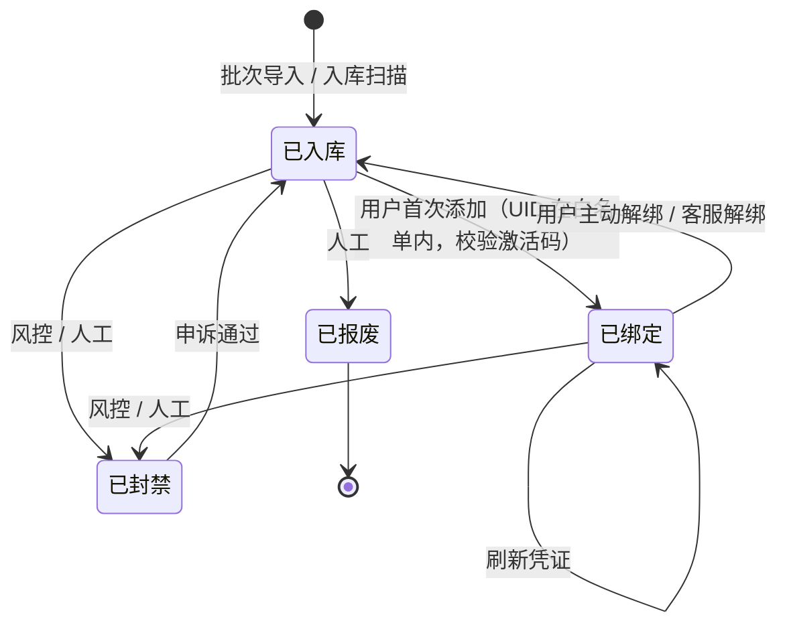
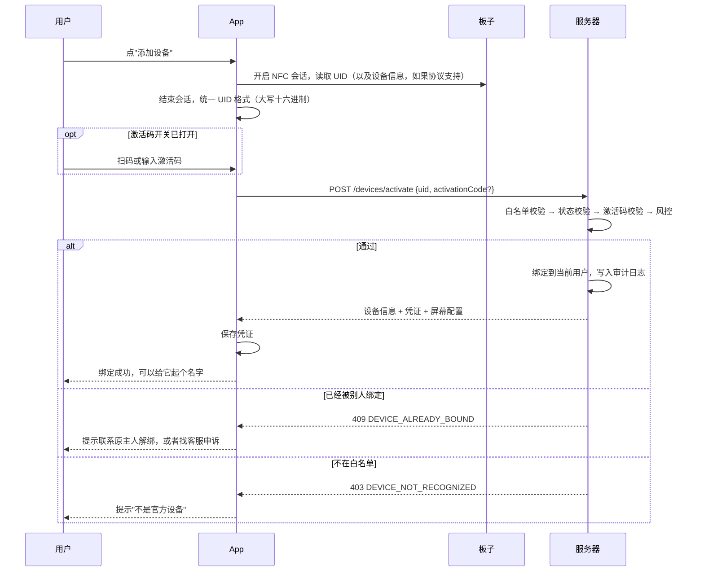
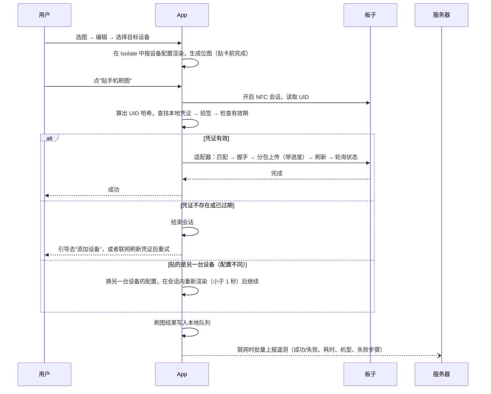
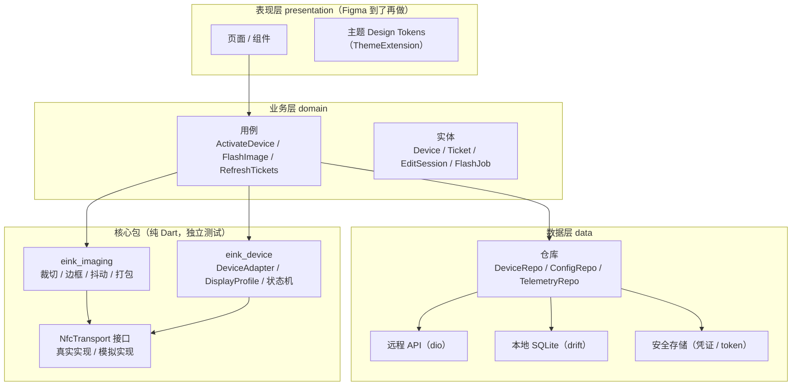
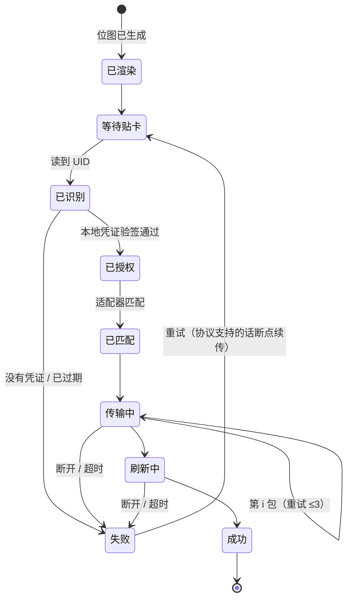

# 墨水屏 NFC 相框：全栈架构设计 v0.1

> **当前状态**：Figma 设计稿还没有，厂家 NFC 协议还没有。
> **本文目标**：先把**和设计稿、协议都无关的部分**定下来，马上可以开工；等协议和设计稿到了，只需要补上"适配器"和"UI 皮肤"两块。
> **已经确定的决策**：用**白名单**保证 App 只对我们自己的板子生效。

---

## 0. 设计原则

| # | 原则 | 落到哪里 |
|---|---|---|
| 1 | **只认自己的板子** | UID 白名单 + 账号首次绑定 + 服务器签名的设备凭证 |
| 2 | **不被单一供应商卡住** | 设备适配器 + 屏幕配置（DisplayProfile）可插拔 |
| 3 | **NFC 阶段只负责传输** | 所有计算和联网校验都在贴卡**之前**完成 |
| 4 | **能离线刷图** | 设备凭证离线有效（默认 30 天），不依赖实时联网 |
| 5 | **密钥不放客户端** | App 里只放公钥；私钥、白名单、风控规则都在服务器 |
| 6 | **照片不上传** | 照片只在本地处理，降低隐私合规风险和服务器成本 |
| 7 | **没有硬件也能开发** | 模拟传输层 + 虚拟墨水屏，UI 和流程可以先做 |
| 8 | **参数配置化** | 调色板、超时、包大小、功能开关都可以从服务器下发，不用发版 |

---

## 1. 整体架构

```mermaid
flowchart TB
    subgraph Client["📱 Flutter App（iOS / Android）"]
        UI["UI 层（等 Figma 设计稿）"]
        APP["业务层<br/>设备管理 / 编辑 / 刷图编排"]
        IMG["图像管线<br/>纯 Dart 包"]
        DEV["设备层<br/>适配器 + 屏幕配置"]
        NFC["NFC 传输层"]
        LOCAL["本地存储<br/>SQLite + 安全存储"]
        API["API 客户端<br/>HTTPS + 证书锁定"]
        UI --> APP --> IMG
        APP --> DEV --> NFC
        APP --> LOCAL
        APP --> API
    end

    subgraph Server["☁️ 后端服务"]
        GW["网关<br/>Nginx / 云负载均衡 + 限流"]
        SVC["应用服务（无状态）<br/>认证 / 设备 / 凭证 / 配置 / 遥测"]
        PG[("PostgreSQL")]
        RD[("Redis")]
        KMS["KMS<br/>凭证签名私钥"]
        OSS["对象存储 + CDN<br/>边框模板 / 素材"]
        GW --> SVC
        SVC --> PG & RD & KMS & OSS
    end

    subgraph Ops["🛠 运营端"]
        ADMIN["管理后台（Web）<br/>批次导入 / 白名单 / 设备 / 配置 / 统计"]
        TOOL["入库工具（Python + ACR122U）<br/>扫描 UID / 登记白名单 / 打印激活码"]
    end

    API --> GW
    ADMIN --> GW
    TOOL --> GW
    NFC -. 13.56MHz .-> BOARD["🖼 墨水屏板子"]
    TOOL -. 读卡器 .-> BOARD
    SVC -. 监控 / 报错 .-> MON["Sentry / Prometheus / 日志"]
```

### 组件和技术选型

| 组件 | 选型（建议） | 说明 |
|---|---|---|
| App | Flutter 3.x + Riverpod + go_router | 一套代码覆盖两端 |
| 后端 | **你最熟悉的语言**（Go / Java Spring Boot / Node NestJS 都可以） | 本文用 OpenAPI + SQL 描述，和语言无关 |
| 数据库 | PostgreSQL 15+ | 设备、用户、绑定、日志 |
| 缓存 | Redis | 限流、短信验证码、配置缓存 |
| 签名密钥 | 云 KMS（阿里云、腾讯云）或者先用加密文件存放 | Ed25519 私钥，用来签发设备凭证 |
| 对象存储 | OSS / COS + CDN | 边框模板、素材（**不存用户照片**） |
| 管理后台 | React + Ant Design Pro，或 Vue + Element Plus | 内部使用，够用就行 |
| 部署 | Docker + 一台云服务器起步，以后再扩容 | 无状态服务，可以水平扩展 |
| 监控 | Sentry（App 和后端报错）+ 云监控 / Prometheus | 刷图失败率是核心指标 |

---

## 2. 核心难点：只认自己的板子（白名单方案）

### 2.1 白名单本身的弱点和补强

单纯"UID 在名单里就放行"有几个漏洞，用下面几项补强：

| 漏洞 | 补强措施 |
|---|---|
| UID 是明文，可以被伪造 | **一台设备只能绑定一个账号**：克隆一个已经被绑定的 UID 也没用 |
| 有人抢先绑定别人的设备 | 可选的**激活码**：包装里放一张卡，没有激活码不能绑定 |
| 同一个 UID 在多个账号、多个地方出现 | **风控**：异常时报警，可以在后台封禁设备 |
| App 被破解、去掉校验 | 凭证用服务器私钥签名，App 里只有公钥，没法伪造；配合代码混淆 |
| 别人的通用板子 | 不在白名单里，直接拒绝；如果有专属 AID，适配器层也匹配不上 |
| 每次刷图都要联网 | **离线凭证**：绑定后下发签名凭证，有效期内可以离线刷图 |

> [!WARNING]
> **必须先找厂家确认：板子的 UID 是固定的**。有的芯片出于隐私考虑，每次上电都会生成随机 UID，那样白名单方案就完全不成立。可以用 NXP TagInfo 贴几次看看 UID 是否变化。

### 2.2 设备生命周期



### 2.3 白名单的数据来源（两种方式，可以同时用）

| 方式 | 流程 | 优缺点 |
|---|---|---|
| **A：厂家提供 UID 清单** | 每批出货附一个 CSV，在管理后台导入，生成一个批次 | 省事；但要相信厂家的清单准确 |
| **B：自己入库扫描（推荐）** | 收货后用电脑加 ACR122U 逐台扫描，脚本自动登记，同时打印激活码标签 | 每台约 2 秒；顺便做了收货质检，数据可靠 |

### 2.4 激活码（可选，用功能开关控制）

```
激活码 = Base32(HMAC-SHA256(激活码密钥, UID))[:8]   例如：K7P2-QX9M
```

- 由服务器根据 UID **算出来**，不需要额外存储，入库时直接打印到包装卡上
- 绑定时服务器重新算一遍并比对，**输错 5 次锁定 1 小时**
- 第一版可以先关掉（只用"白名单 + 首次绑定"），以后发现被抢绑时再打开

### 2.5 离线设备凭证（Device Ticket）

绑定成功或者每次在线刷新时，服务器签发：

```jsonc
// payload（JSON → Base64URL），签名算法 Ed25519
{
  "v": 1,
  "kid": "2026-10",           // 签名密钥编号，方便以后轮换
  "did": "dev_8f3a...",       // 设备 ID（服务器内部 ID）
  "uidh": "sha256(盐+UID)",    // UID 的哈希，App 贴卡后算一遍做比对
  "uid": "user_12ab...",      // 绑定的用户
  "prof": "vA-400x300-bwry",  // 屏幕配置 ID
  "adp": "vendorA@1",         // 适配器 ID
  "iat": 1761460000,
  "exp": 1764052000           // 默认 30 天
}
// ticket = base64url(payload) + "." + base64url(signature)
```

- App 内置**公钥列表**（按 kid 区分），**本地验签**，不需要联网
- 每次 App 启动或在线时，在后台刷新快过期的凭证
- 设备被封禁或解绑后，下次刷新就失败；离线最长也只能再用到 `exp`
- 凭证存在 `flutter_secure_storage`（iOS 钥匙串 / Android Keystore）

> [!NOTE]
> 为什么不每次刷图都在线校验？因为 iOS 的 NFC 会话只有大约 60 秒，**网络请求放在会话里会浪费时间，还会因为网络差导致刷图失败**。所以联网校验放在贴卡之前或者之后，贴卡时只做本地验签（毫秒级）。

---

## 3. 关键流程

### 3.1 添加设备（首次绑定）



### 3.2 刷图（核心流程）



### 3.3 解绑和转让

- **用户主动解绑**：App 中操作 → 设备回到"已入库"状态 → 新主人可以重新绑定
- **二手转让但原主人没解绑**：新主人提交申诉（附上购买凭证或激活码）→ 客服在后台处理
- 所有绑定和解绑操作都写**审计日志**

---

## 4. 客户端架构（Flutter）

### 4.1 分层



### 4.2 核心接口

```dart
/// 传输层：只负责收发字节，方便替换成模拟实现
abstract class NfcTransport {
  Future<TagInfo> connect({String? iosAlert});   // 返回 UID、协议类型
  Future<Uint8List> transceive(Uint8List apdu, {Duration? timeout});
  Future<void> setProgressMessage(String msg);   // iOS 系统弹框文案
  Future<void> close({String? message, bool error = false});
}

/// 屏幕配置：可以从服务器下发
class DisplayProfile {
  final String id;               // vA-400x300-bwry
  final int width, height;
  final List<int> paletteRgb;    // 实测调色板
  final PackFormat pack;         // 每像素位数、颜色编码、位序、扫描方向
  final int maxChunk;            // 单包最大字节数
  final Duration refreshTimeout;
}

/// 设备适配器：每家厂家一个实现
abstract class DeviceAdapter {
  String get id;                                      // vendorA@1
  Future<bool> matches(NfcTransport t, TagInfo tag);  // 例如 SELECT AID 是否成功
  Future<DeviceInfo?> readInfo(NfcTransport t);       // 协议支持的话
  Stream<FlashProgress> flash(NfcTransport t, Uint8List bitmap, DisplayProfile p);
}
```

### 4.3 刷图状态机（`FlashJob`）



每次失败都记录 `failedStep`、`errorCode`、`chunkIndex`、机型、系统版本，用来统计失败原因。

### 4.4 主要依赖

| 用途 | 包 |
|---|---|
| 状态管理 / 路由 | flutter_riverpod、go_router |
| 网络 | dio（拦截器负责 token 刷新、重试）+ 证书锁定 |
| 数据模型 | freezed、json_serializable |
| 本地数据库 | drift（SQLite） |
| 安全存储 | flutter_secure_storage |
| 验签 | cryptography（Ed25519） |
| NFC | flutter_nfc_kit |
| 选图 / 裁切 | image_picker、crop_your_image |
| 图像 | image + 手写抖动 |
| 报错 | sentry_flutter |
| 多语言 | flutter_localizations + intl（预留） |

### 4.5 本地数据

| 表或存储 | 内容 |
|---|---|
| `devices`（SQLite） | 设备 ID、昵称、配置 ID、适配器 ID、最近刷图时间 |
| `tickets`（安全存储） | 每台设备的凭证 |
| `works`（SQLite + 文件） | 作品历史：编辑参数、缩略图、位图缓存 |
| `telemetry_queue`（SQLite） | 待上报的刷图记录 |
| `remote_config`（SQLite） | 服务器下发的配置缓存（附带版本号） |

---

## 5. 服务端架构

### 5.1 模块

| 模块 | 职责 |
|---|---|
| `auth` | 手机号验证码登录、Sign in with Apple、token 签发和刷新 |
| `user` | 用户资料、注销账号（合规要求） |
| `device` | 白名单、绑定和解绑、状态机、风控 |
| `ticket` | 设备凭证签发和刷新、签名密钥轮换 |
| `batch` | 批次导入（CSV）、入库工具接口 |
| `config` | 远程配置：屏幕配置、调色板、功能开关、最低 App 版本 |
| `telemetry` | 刷图记录接收和统计 |
| `asset` | 边框模板、素材 |
| `admin` | 管理后台接口、角色权限、审计日志 |

> 建议先做成**单体应用 + 按模块分包**，不要一开始就拆微服务。

### 5.2 数据模型（简化）

```sql
-- 供应商和屏幕配置
CREATE TABLE vendors (
  id TEXT PRIMARY KEY,            -- vendorA
  name TEXT NOT NULL,
  status TEXT NOT NULL DEFAULT 'active'
);

CREATE TABLE display_profiles (
  id TEXT PRIMARY KEY,            -- vA-400x300-bwry
  vendor_id TEXT REFERENCES vendors(id),
  adapter_id TEXT NOT NULL,       -- vendorA@1
  width INT, height INT,
  palette JSONB NOT NULL,         -- 实测调色板
  pack_format JSONB NOT NULL,
  params JSONB NOT NULL,          -- 包大小、超时等
  version INT NOT NULL DEFAULT 1
);

-- 批次和设备（白名单）
CREATE TABLE device_batches (
  id BIGSERIAL PRIMARY KEY,
  vendor_id TEXT REFERENCES vendors(id),
  profile_id TEXT REFERENCES display_profiles(id),
  source TEXT NOT NULL,           -- vendor_csv / scan_tool
  quantity INT,
  created_by BIGINT, created_at TIMESTAMPTZ DEFAULT now()
);

CREATE TABLE devices (
  id TEXT PRIMARY KEY,                    -- dev_xxx
  uid_hmac BYTEA UNIQUE NOT NULL,         -- HMAC(服务器密钥, 统一格式后的 UID)，不存明文
  uid_last4 TEXT,                         -- 方便客服核对
  batch_id BIGINT REFERENCES device_batches(id),
  profile_id TEXT REFERENCES display_profiles(id),
  status TEXT NOT NULL DEFAULT 'in_stock',-- in_stock / bound / blocked / retired
  owner_user_id BIGINT,
  bound_at TIMESTAMPTZ,
  activation_fail_count INT DEFAULT 0,
  updated_at TIMESTAMPTZ DEFAULT now()
);

-- 用户
CREATE TABLE users (
  id BIGSERIAL PRIMARY KEY,
  phone_hash BYTEA UNIQUE,
  apple_sub TEXT UNIQUE,
  status TEXT NOT NULL DEFAULT 'active',
  created_at TIMESTAMPTZ DEFAULT now(),
  deleted_at TIMESTAMPTZ
);

-- 绑定历史 / 审计
CREATE TABLE device_binding_events (
  id BIGSERIAL PRIMARY KEY,
  device_id TEXT REFERENCES devices(id),
  user_id BIGINT,
  action TEXT NOT NULL,           -- bind / unbind / admin_unbind / block / unblock
  operator TEXT,                  -- user / admin:xx / system
  ip INET, client_info JSONB,
  created_at TIMESTAMPTZ DEFAULT now()
);

-- 刷图遥测
CREATE TABLE flash_logs (
  id BIGSERIAL PRIMARY KEY,
  device_id TEXT, user_id BIGINT,
  result TEXT,                    -- success / fail
  failed_step TEXT, error_code TEXT,
  duration_ms INT, chunks INT,
  platform TEXT, os_version TEXT, phone_model TEXT, app_version TEXT,
  created_at TIMESTAMPTZ DEFAULT now()
);   -- 数据量大了以后按月分区

-- 远程配置
CREATE TABLE app_configs (
  key TEXT PRIMARY KEY, value JSONB NOT NULL,
  platform TEXT DEFAULT 'all', min_app_version TEXT,
  updated_at TIMESTAMPTZ DEFAULT now()
);
```

### 5.3 API 概览（REST，用 OpenAPI 描述，客户端代码自动生成）

| 方法 | 路径 | 说明 |
|---|---|---|
| POST | `/v1/auth/sms/send` | 发送验证码（限流） |
| POST | `/v1/auth/sms/login` | 验证码登录 |
| POST | `/v1/auth/apple` | Sign in with Apple |
| POST | `/v1/auth/refresh` | 刷新 token（refresh token 轮换） |
| DELETE | `/v1/me` | 注销账号 |
| POST | `/v1/devices/activate` | 绑定设备 → 返回凭证 |
| GET | `/v1/devices` | 我的设备列表 |
| PATCH | `/v1/devices/{id}` | 修改昵称 |
| DELETE | `/v1/devices/{id}/binding` | 解绑 |
| POST | `/v1/devices/tickets/refresh` | 批量刷新凭证 |
| GET | `/v1/config?since={version}` | 远程配置 + 屏幕配置（增量） |
| POST | `/v1/telemetry/flash` | 批量上报刷图记录 |
| GET | `/v1/assets/frames` | 边框模板列表 |
| — | `/admin/v1/...` | 管理后台：批次、设备、用户、配置、统计、审计 |
| POST | `/tool/v1/devices/register` | 入库工具：登记 UID → 返回激活码（单独的工具 token） |

**错误码规范**（App 根据错误码展示文案）：

| 错误码 | HTTP | 含义 |
|---|---|---|
| `DEVICE_NOT_RECOGNIZED` | 403 | 不在白名单 |
| `DEVICE_ALREADY_BOUND` | 409 | 已经被别人绑定 |
| `DEVICE_BLOCKED` | 403 | 已封禁 |
| `ACTIVATION_CODE_INVALID` | 400 | 激活码错误 |
| `TOO_MANY_ATTEMPTS` | 429 | 尝试次数过多 |
| `APP_VERSION_TOO_OLD` | 426 | 需要强制更新 |

### 5.4 风控规则（第一版）

- 同一个 UID 24 小时内被不同账号尝试绑定 ≥ 3 次 → 报警
- 同一个账号 1 小时内尝试绑定不在白名单的 UID ≥ 5 次 → 临时限制
- 同一个账号绑定的设备数量 > 20 → 人工审核（数量可配置）
- 激活码连续错误 5 次 → 锁定这台设备 1 小时
- 所有限流计数放在 Redis，滑动窗口

---

## 6. 稳定性设计

### 6.1 NFC 和刷图

| 问题 | 设计 |
|---|---|
| iOS 会话约 60 秒 | 渲染和联网都放在会话外；会话内只做传输；记录每个阶段的耗时 |
| 手机移动导致断开 | 单包失败重试（默认 3 次）；按偏移量写入（重复写是幂等的）；协议支持的话断点续传 |
| 刷新时间长 | 轮询间隔和超时从配置下发；UI 显示刷新倒计时，提醒用户不要移动 |
| Android 系统弹出其他 NFC 处理界面 | 用 Reader Mode（`FLAG_READER_SKIP_NDEF_CHECK`），在刷图页面独占 NFC |
| Android 和 iOS 的 UID 字节序可能不一样 | 统一转成大写十六进制；**两个平台都要实测同一台设备**；写单元测试 |
| 手机没有 NFC 或者 NFC 没打开 | 启动时检测，引导用户去设置里打开；没有 NFC 的手机给出明确提示 |
| 贴错了设备 | 先读 UID，再匹配凭证和配置，需要时在会话内重新渲染 |

### 6.2 图像管线

| 问题 | 设计 |
|---|---|
| 大图导致内存溢出 | 解码时先按目标尺寸降采样；单张限制最长边（比如 4096） |
| HEIC、EXIF 方向 | 统一转换和纠正方向 |
| 主线程卡顿 | 全部放在 Isolate 中；编辑时的预览做防抖（300ms） |
| 和 Python 结果不一致 | **Golden 测试**：同一个输入，位图必须和参考 bin 逐字节一致 |

### 6.3 客户端整体

- **强制更新**：`min_app_version` 由服务器控制（协议有重大变更时用）
- **功能开关**：激活码、新适配器、新功能都可以按开关逐步放量
- **离线可用**：凭证、配置、素材都有本地缓存
- **崩溃和报错上报**：Sentry，带上脱敏后的上下文
- **遥测**：只上报刷图结果和技术参数，不上报照片内容

### 6.4 服务端

- 无状态服务、健康检查、自动重启（Docker / 云服务）
- 数据库每日自动备份 + 时间点恢复
- 接口统一做超时、限流、幂等（绑定接口按 UID 加锁）
- 监控核心指标：**刷图成功率**、绑定失败率、接口 P99 延迟、报错率

---

## 7. 安全设计

| 层面 | 措施 |
|---|---|
| 传输 | 全站 HTTPS（TLS 1.2+），App 端**证书锁定**（锁公钥，准备好备用公钥） |
| 认证 | access token 15 分钟 + refresh token 30 天、每次刷新都轮换，可以吊销 |
| 设备凭证 | Ed25519 签名，**私钥放在 KMS**，App 只有公钥；有 kid，支持密钥轮换 |
| UID 存储 | 只存 HMAC 结果和后 4 位，不存明文 |
| 客户端 | Flutter 混淆（`--obfuscate --split-debug-info`）；不在 App 里放任何密钥 |
| 防破解（可选） | Root / 越狱检测只做上报，不阻止使用，避免误伤 |
| 管理后台 | 只允许内网或 IP 白名单访问 + 双因素认证 + 角色权限 + 操作审计 |
| 入库工具 | 单独的工具 token，可以限制数量和有效期，所有调用都记录日志 |
| 接口 | 参数校验、限流、防止重放（重要接口带时间戳和随机数） |
| 数据最小化 | 照片不上传；手机号做哈希；遥测里不放个人信息 |

---

## 8. 合规和上架（国内）

| 事项 | 说明 |
|---|---|
| **ICP 备案** | 后端的 API 域名需要备案（大约 1–3 周，**尽早办**） |
| **App 备案** | 国内上架安卓应用市场和 App Store 中国区都需要 App 备案 |
| 软件著作权 | 国内安卓市场上架需要 |
| 隐私政策 + 用户协议 | 首次启动弹窗同意；说明清楚：照片只在本地处理、不上传 |
| 注销账号 | App Store 要求 App 内可以注销账号 |
| Sign in with Apple | 如果接入微信等第三方登录，iOS 端必须同时提供 Apple 登录 |
| NFC 用途描述 | Info.plist：「使用 NFC 向电子墨水屏相框传输照片」 |
| 审核演示 | 审核员没有硬件：附上演示视频；提供测试账号；说明需要配套硬件 |

---

## 9. 在没有协议和设计稿时怎么开发

### 9.1 模拟传输层 + 虚拟墨水屏

```dart
/// 在内存里模拟一块板子，实现一套"假协议"
class SimulatedBoard {
  final Uint8List uid;
  final Uint8List frameBuffer = Uint8List(30000);
  Uint8List handle(Uint8List apdu) { /* 解析 SELECT / 写数据 / 刷新 / 查询状态 */ }
}

class FakeNfcTransport implements NfcTransport {
  final SimulatedBoard board;
  final double dropRate;     // 模拟随机断开
  final Duration latency;    // 模拟每包延迟
  ...
}
```

- 调试模式下增加一个"**虚拟墨水屏**"页面：把模拟板子收到的位图解码显示出来，**端到端验证整个刷图流程**
- 可以模拟断开、超时、错误码，用来测试状态机和异常界面
- 协议到了以后，只要新写一个 `VendorAAdapter`，并让 `SimulatedBoard` 按真实协议响应

> [!TIP]
> 进阶做法：用另一台安卓手机的 **HCE（主机卡模拟）**模拟一块板子，可以在没有硬件的情况下测试真实的 NFC 链路。

### 9.2 UI 先用"线框皮肤"

- 页面结构、路由、状态全部先做好，样式用简单的线框风格
- 所有颜色、字号、间距都**通过 Design Tokens（ThemeExtension）获取**，不写死
- Figma 到了以后，按《设计交付规范》把 Tokens 换掉，再精修组件

---

## 10. 仓库结构（单仓库）

```
eink-frame/
├── apps/
│   ├── mobile/                  # Flutter App
│   │   ├── lib/
│   │   │   ├── app/             # 路由、主题、依赖注入
│   │   │   ├── features/        # device/ editor/ flash/ works/ settings/ auth/
│   │   │   ├── data/            # api/ db/ secure/ repositories/
│   │   │   └── domain/          # entities/ usecases/
│   │   ├── test/  integration_test/
│   │   ├── android/  ios/
│   └── admin/                   # 管理后台（Web）
├── packages/
│   ├── eink_imaging/            # 纯 Dart：裁切、边框、抖动、打包 + golden 测试
│   └── eink_device/             # 纯 Dart：传输接口、适配器、配置、状态机、模拟板子
├── server/                      # 后端服务
│   ├── api/openapi.yaml         # 接口定义（唯一标准）
│   ├── migrations/              # 数据库迁移
│   └── src/ ...
├── tools/
│   ├── reference/               # Python 参考实现（抖动、打包）→ 生成 golden 文件
│   ├── intake/                  # 入库工具：pyscard + ACR122U + 打印激活码
│   └── protocol_debug/          # 协议调试脚本
├── docs/                        # 架构、协议、调色板实测、决策记录（ADR）
└── .github/workflows/           # CI：测试、构建、golden 比对
```

---

## 11. 分阶段计划

| 阶段 | 依赖 | 内容 |
|---|---|---|
| **P0 现在就能做** | 无 | 单仓库和 CI；后端的认证、白名单、绑定、凭证、配置、遥测；管理后台的批次导入和设备管理；App 骨架（路由、状态、API、安全存储、凭证验签）；图像管线（先假设 400×300 四色）+ Python 参考实现 + golden 测试；模拟板子 + 刷图状态机 + 虚拟墨水屏 |
| **P1 拿到样板（还没有协议）** | 样板 | 用 TagInfo 确认 UID 是否固定、协议类型；验证两个平台读到的 UID 是否一致；入库工具读 UID 并登记 |
| **P2 拿到协议** | 协议文档 | 用 Python 在电脑上刷出第一张图；写 `VendorAAdapter`；实测调色板；Android 打通 → iOS 打通 |
| **P3 拿到设计稿** | Figma | 替换 Tokens、实现页面、动效、引导动画 |
| **P4 打磨上线** | 全部 | 多机型测试、压力测试、备案、上架材料、灰度发布 |

---

## 12. 待确认问题

### 问厂家
- [ ] **UID 是固定的吗？**（白名单方案的前提）
- [ ] 芯片协议类型（ISO14443-4？）和 AID；iOS 能不能读到
- [ ] 能不能提供每批出货的 UID 清单？什么格式？
- [ ] 能不能定制专属 AID（作为第二道识别）？
- [ ] 有没有读取设备信息的指令（型号、固件版本）？
- [ ] 支持断点续传 / 刷新状态查询吗？

### 产品决策
- [ ] 登录方式：手机号验证码？是否接入微信（接入的话要同时提供 Apple 登录）？
- [ ] 第一版要不要开启激活码？（建议先关闭，预留开关）
- [ ] 离线凭证的有效期：30 天是否合适？
- [ ] 一个账号最多绑定几台设备？是否支持家人共享同一台设备？
- [ ] 是否允许不登录先体验（只能编辑预览，不能刷图）？
- [ ] 后端用哪种语言？
