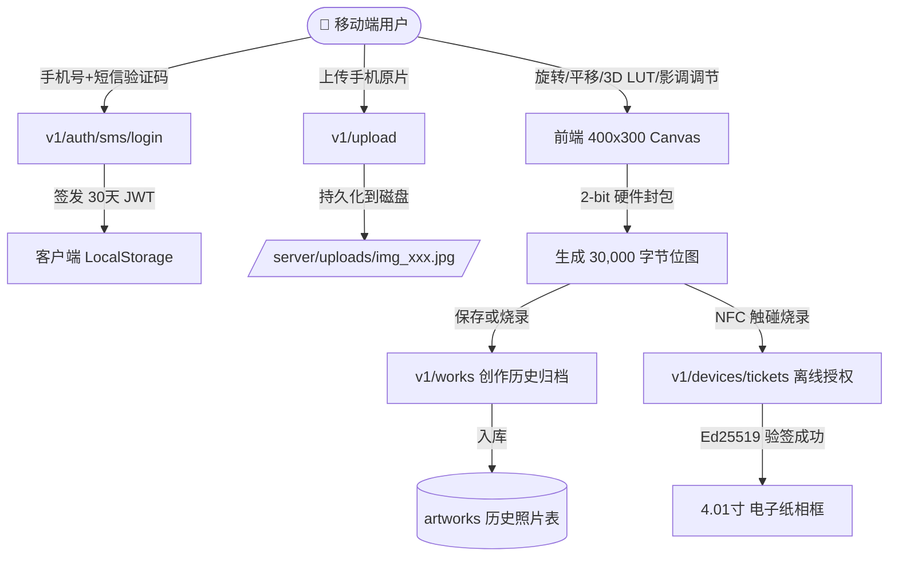

# 🗄️ E-Ink Photo Frame 数据库表结构与数据流设计规范

> **项目名称**：E-Ink NFC 4-Color Photo Frame (四色墨水屏复古电子相框)  
> **适用引擎**：SQLite 3 (单机开发与本地联调) / PostgreSQL 14+ (生产云端集群)  
> **ORM 框架**：Go GORM (支持代码优先自动迁移 `AutoMigrate`)  
> **设计版本**：v1.2.0 (增补用户登录体系、验证码防刷审计表与历史照片作品归档表)  

---

## 1. 架构设计哲学与数据流

本系统的数据模型围绕“**用户鉴权 $\rightarrow$ 照片上传与暗室创作 $\rightarrow$ 历史作品归档 $\rightarrow$ NFC 硬件安全烧录**”闭环展开：



---

## 2. 核心数据表结构定义

### 2.1 用户主表 (`users`)

记录使用相框 App 的终端用户基本信息与登录审计状态。

| 字段名 | 类型 | 约束 / 索引 | 默认值 | 描述 |
| :--- | :--- | :--- | :--- | :--- |
| `id` | `BIGINT UNSIGNED` | `PRIMARY KEY, AUTO_INCREMENT` | - | 用户全局唯一主键 ID |
| `phone` | `VARCHAR(32)` | `UNIQUE INDEX, NOT NULL` | - | 手机号码（中国大陆 E.164 格式） |
| `nickname` | `VARCHAR(64)` | - | `用户XXXX` | 用户个性昵称（默认以手机后4位生成） |
| `avatar_url` | `VARCHAR(255)` | - | `""` | 用户头像地址 |
| `status` | `VARCHAR(16)` | `INDEX` | `'active'` | 状态：`active` (正常), `disabled` (封禁), `deleted` (已注销) |
| `last_login_at` | `DATETIME` | - | `NULL` | 最后一次登录时间戳 |
| `created_at` | `DATETIME` | - | `CURRENT_TIMESTAMP` | 账号注册时间 |
| `updated_at` | `DATETIME` | - | `CURRENT_TIMESTAMP` | 资料最后修改时间 |

```sql
CREATE TABLE `users` (
  `id` INTEGER PRIMARY KEY AUTOINCREMENT,
  `phone` VARCHAR(32) NOT NULL,
  `nickname` VARCHAR(64),
  `avatar_url` VARCHAR(255),
  `status` VARCHAR(16) DEFAULT 'active',
  `last_login_at` DATETIME,
  `created_at` DATETIME,
  `updated_at` DATETIME
);
CREATE UNIQUE INDEX `idx_users_phone` ON `users` (`phone`);
```

---

### 2.2 短信验证码审计与防刷表 (`sms_verification_codes`)

针对登录与注册流程的验证码进行持久化记录，用于风控防刷、频率限制（单日单 IP/单手机号上限）与安全审计。

| 字段名 | 类型 | 约束 / 索引 | 默认值 | 描述 |
| :--- | :--- | :--- | :--- | :--- |
| `id` | `BIGINT UNSIGNED` | `PRIMARY KEY, AUTO_INCREMENT` | - | 主键自增 ID |
| `phone` | `VARCHAR(32)` | `INDEX, NOT NULL` | - | 接收验证码的手机号 |
| `code` | `VARCHAR(16)` | `NOT NULL` | - | 验证码明文或脱敏摘要 |
| `purpose` | `VARCHAR(32)` | `DEFAULT 'login'` | `'login'` | 业务用途：`login` (登录), `bind` (绑定设备), `reset` (注销重置) |
| `status` | `VARCHAR(16)` | `DEFAULT 'pending'` | `'pending'` | 状态：`pending` (未使用), `used` (已验证), `expired` (已过期) |
| `ip` | `VARCHAR(64)` | - | `""` | 客户端发起请求的 IP 地址 |
| `expires_at` | `DATETIME` | `INDEX` | - | 验证码失效时间（默认颁发后 10 分钟） |
| `created_at` | `DATETIME` | - | `CURRENT_TIMESTAMP` | 发送时间戳 |

```sql
CREATE TABLE `sms_verification_codes` (
  `id` INTEGER PRIMARY KEY AUTOINCREMENT,
  `phone` VARCHAR(32) NOT NULL,
  `code` VARCHAR(16) NOT NULL,
  `purpose` VARCHAR(32) DEFAULT 'login',
  `status` VARCHAR(16) DEFAULT 'pending',
  `ip` VARCHAR(64),
  `expires_at` DATETIME,
  `created_at` DATETIME
);
CREATE INDEX `idx_sms_phone` ON `sms_verification_codes` (`phone`);
```

---

### 2.3 用户上传与创作历史照片作品表 (`artworks`)

本表为相框应用的核心业务资产表。既保存了用户上传的**原始照片**，又保存了**调色后 400x300 渲染预览图**，更独家存储了**完整的构图与调色参数快照（`params_json`）**和**直接烧录用的 30,000 字节二进制位图**，实现“随时随地无损还原现场”。

| 字段名 | 类型 | 约束 / 索引 | 默认值 | 描述 |
| :--- | :--- | :--- | :--- | :--- |
| `id` | `VARCHAR(64)` | `PRIMARY KEY` | - | 作品全局唯一编号（如 `art_a1b2c3d4e5f6`） |
| `user_id` | `BIGINT UNSIGNED` | `INDEX, NOT NULL` | - | 归属用户 ID（关联 `users.id`） |
| `title` | `VARCHAR(128)` | `NOT NULL` | `'Untitled'` | 用户自定义作品标题 |
| `subtitle` | `VARCHAR(128)` | - | `""` | 拍立得相框底部刻字水印 |
| `original_image_url` | `TEXT` | - | `""` | 手机上传原图访问路径（如 `/uploads/img_xxx.jpg`） |
| `rendered_preview_url` | `TEXT` | - | `""` | 400x300 墨水屏效果渲染图（DataURL 或 WebP 路径） |
| `bitmap_base64` | `TEXT` | - | `""` | 4色 2-bit 封包数据（30,000 字节的 Base64，供一键复烧） |
| `bitmap_hash` | `VARCHAR(64)` | - | `""` | 30KB 位图 SHA-256 哈希值（用于设备刷屏去重校验） |
| `bitmap_size` | `INTEGER` | - | `30000` | 二进制封包大小（400×300 屏固定 30,000 字节） |
| `filter_id` | `VARCHAR(64)` | - | `""` | 使用的 RNI 3D 胶片预设 ID（如 `polaroid_600`, `fuji_fp_100c`） |
| `frame_id` | `VARCHAR(64)` | - | `'polaroid'` | 画框模板（`polaroid` 白边 / `full` 无边框） |
| `dither_method` | `VARCHAR(32)` | - | `'atkinson'` | 抖动算法：`atkinson` 或 `floyd_steinberg` |
| **`params_json`** | `TEXT` | - | `"{}"` | **暗室全量编辑参数快照**（包含旋转、翻转、缩放、平移X/Y、亮度、对比度、饱和度、色温、锐度、防红斑阻尼） |
| `target_device_id` | `VARCHAR(64)` | - | `""` | 最近一次烧录的墨水屏硬件设备 ID |
| `flashed_count` | `INTEGER` | - | `0` | 累计成功无线烧录到相框的次数 |
| `last_flashed_at` | `DATETIME` | - | `NULL` | 最近一次烧录时间 |
| `created_at` | `DATETIME` | `INDEX` | `CURRENT_TIMESTAMP` | 创作与上传保存时间 |
| `updated_at` | `DATETIME` | - | `CURRENT_TIMESTAMP` | 修改更新时间 |

#### `params_json` 结构示例：
```json
{
  "rotation": 90,
  "flipH": false,
  "zoom": 1.25,
  "panX": -18,
  "panY": 12,
  "brightness": 8,
  "contrast": 1.25,
  "saturation": 1.15,
  "warmth": 10,
  "sharpness": 0.45,
  "redDamper": 1.18,
  "imageSrc": "/uploads/img_1793789012_a8b9c0.jpg"
}
```

```sql
CREATE TABLE `artworks` (
  `id` VARCHAR(64) PRIMARY KEY,
  `user_id` INTEGER NOT NULL,
  `title` VARCHAR(128) NOT NULL,
  `subtitle` VARCHAR(128),
  `original_image_url` TEXT,
  `rendered_preview_url` TEXT,
  `bitmap_base64` TEXT,
  `bitmap_hash` VARCHAR(64),
  `bitmap_size` INTEGER DEFAULT 30000,
  `filter_id` VARCHAR(64),
  `frame_id` VARCHAR(64),
  `dither_method` VARCHAR(32) DEFAULT 'atkinson',
  `params_json` TEXT,
  `target_device_id` VARCHAR(64),
  `flashed_count` INTEGER DEFAULT 0,
  `last_flashed_at` DATETIME,
  `created_at` DATETIME,
  `updated_at` DATETIME
);
CREATE INDEX `idx_artworks_user_id` ON `artworks` (`user_id`);
CREATE INDEX `idx_artworks_created_at` ON `artworks` (`created_at`);
```

---

### 2.4 设备硬件白名单与绑定表 (`devices`)

保证只有官方采购录入白名单的墨水屏才能获得合法固件刷入签名，防止竞品山寨盗用后台算力。

| 字段名 | 类型 | 约束 / 索引 | 描述 |
| :--- | :--- | :--- | :--- |
| `id` | `VARCHAR(64)` | `PRIMARY KEY` | 逻辑设备 ID (`dev_xxx`) |
| `uid_hmac` | `VARCHAR(64)` | `UNIQUE INDEX, NOT NULL` | 硬件 NFC UID 的 HMAC-SHA256 隐私哈希 |
| `uid_last4` | `VARCHAR(8)` | `INDEX` | UID 后 4 位字符（客服比对防串号） |
| `profile_id` | `VARCHAR(64)` | - | 关联显示器参数规格（如 `vA-400x300-bwry`） |
| `status` | `VARCHAR(16)` | `INDEX` | `in_stock` (待绑定), `bound` (已绑定), `blocked` (风控) |
| `owner_user_id`| `BIGINT UNSIGNED` | `INDEX` | 当前绑定的用户 ID |
| `nickname` | `VARCHAR(64)` | - | 设备摆放昵称（如 "客厅茶几", "书房书架"） |
| `bound_at` | `DATETIME` | - | 首次绑定时间 |
| `last_flashed_at`| `DATETIME`| - | 最近一次成功烧录时间 |

---

## 3. 历史照片作品全生命周期数据流

1. **原图上传保存**：
   - 用户从相册选取大图，调用 `POST /v1/upload`，后端在磁盘生成唯一文件并返回相对 URL `/uploads/img_xxx.jpg`。
2. **暗室参数快照捕获**：
   - 用户在手机端缩放、平移、旋转、套用 RNI 3D 胶片滤镜、拉动 6 大影调滑块。
   - 前端随时点击 `💾 存入相册` 或在 NFC 刷屏成功时，打包当时的 `params_json`、400x300 墨水屏预览 DataURL 及 30KB 二进制封包。
3. **云端与离线双轨留存**：
   - 若用户已登录：通过 `POST /v1/works` 持久化入库到 SQLite/PostgreSQL `artworks` 表。
   - 若用户未登录或处于无网离线状态：前端自动将其降级存入浏览器的 `localStorage (eink_offline_artworks)`，登录后与云端无缝合并展示。
4. **历史相册一键复原编辑现场**：
   - 在「📚 历史」抽屉中点击任意照片卡片，系统读取该记录的 `params_json`，将 Canvas 画面、旋转角、平移量、缩放比、各滑块数值 100% 回填至暗室工作台，支持立刻再次二次创作或直接无线烧录！

---

## 4. Minikube (Kubernetes) 部署与本地联调指南

项目已在 `deploy/` 目录下内置了生产同构的 **PostgreSQL 16 (Alpine)** Kubernetes 部署清单与一键运维脚本：

- **K8s 资源清单**：[`deploy/k8s/postgres.yaml`](file:///Users/Apple/EinkProject/deploy/k8s/postgres.yaml)
  - `Namespace`: `eink-system`
  - `Secret`: `eink-postgres-secret`（默认账号 `eink_user` / `eink_pass_2026`，库名 `eink_db`）
  - `PersistentVolumeClaim`: `eink-postgres-pvc`（`2Gi` 持久化存储卷，Pod 重启数据不丢失）
  - `StatefulSet`: `eink-postgres`（镜像 `postgres:16-alpine`，内存占用仅 ~35MB，附带 `pg_isready` 探针）
  - `Service`: `eink-postgres-svc`（ClusterIP `5432` + NodePort `30432`）
- **初始化 SQL 脚本**：[`deploy/sql/init_schema.sql`](file:///Users/Apple/EinkProject/deploy/sql/init_schema.sql)（全量 11 张表 + `JSONB` 字段 + 索引 + 注释）
- **一键管理脚本**：[`deploy/scripts/db-manage.sh`](file:///Users/Apple/EinkProject/deploy/scripts/db-manage.sh)

### 4.1 常用操作流程

```bash
# 1. 启动 Minikube 并一键部署 PostgreSQL 16 + 初始化全量表结构
./deploy/scripts/db-manage.sh up

# 2. 查看 Pod / PVC / Service 运行状态
./deploy/scripts/db-manage.sh status

# 3. 将 K8s 内的 PostgreSQL 端口转发到宿主机 127.0.0.1:5432
./deploy/scripts/db-manage.sh forward

# 4. 启动 Go 后端并自动连接 PostgreSQL 实例
./deploy/scripts/db-manage.sh run-api

# 5. 进入容器内 psql 交互终端查表调试
./deploy/scripts/db-manage.sh cli
```

---

## 5. MySQL 开发者转 PostgreSQL 速查对照表

如果你平时习惯使用 MySQL，在通过 `./deploy/scripts/db-manage.sh cli` 进入 `psql` 终端或使用 Navicat / DataGrip / DBeaver 连接时，只需注意以下几处高频差异：

| 操作目的 | MySQL 常用写法 | PostgreSQL (`psql`) 对应写法 | 说明 |
| :--- | :--- | :--- | :--- |
| **查看所有数据库** | `SHOW DATABASES;` | `\l` | 列出所有 database |
| **切换数据库** | `USE eink_db;` | `\c eink_db` | 切换到指定库 |
| **查看所有数据表** | `SHOW TABLES;` | `\dt` | 列出当前 `public` schema 下的所有表 |
| **查看表结构详情** | `DESC users;` 或 `SHOW CREATE TABLE users;` | `\d users` 或 `\d+ users` | 查看字段类型、索引、非空约束与注释 |
| **查看所有索引** | `SHOW INDEX FROM artworks;` | `\di` | 也可通过 `\d artworks` 直接在底部看到全部索引 |
| **退出终端** | `exit` / `quit` | `\q` | 退出 `psql` 命令行 |
| **自增主键** | `BIGINT UNSIGNED AUTO_INCREMENT` | `BIGSERIAL PRIMARY KEY` | PG 自动创建关联 Sequence，GORM 无缝映射 |
| **标识符引号** | 反引号 `` `user_id` `` | 双引号 `"user_id"` 或不加 | PG 中单引号 `'...'` 仅表示字符串字面量 |
| **JSON 查询** | `JSON_EXTRACT(params_json, '$.filter_id')` | `params_json->>'filter_id'` | PG 的 `JSONB` 支持 `->`（返回 JSON）与 `->>`（返回文本）及 GIN 索引 |
| **布尔值类型** | `TINYINT(1)` (`0` / `1`) | `BOOLEAN` (`TRUE` / `FALSE`) | 标准 SQL 布尔类型 |
| **Upsert (冲突更新)**| `ON DUPLICATE KEY UPDATE ...` | `ON CONFLICT (id) DO UPDATE SET ...`| 幂等写入语法更加明确 |

