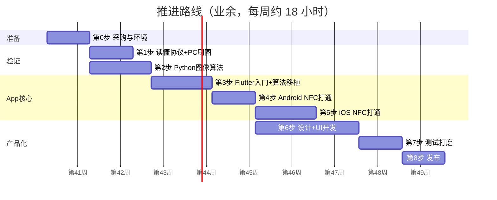

# 墨水屏 NFC 相框：推进路线图

> **前提**：板子向厂家购买；你是后端开发者，擅长 AI 编程，没有移动端和硬件经验。
> **节奏**：业余投入，每周约 18 小时（工作日每天 2 小时，周末 1 天 6–8 小时），总计约 **9–10 周**。
> **三条线**：📘 学习线　🛠 开发线　🎨 设计线。每一步都标出了这三条线各自要做的事。

---

## 总览

| 步骤 | 一句话目标 | 里程碑 |
|---|---|---|
| 0 | 东西到手、环境装好 | 两端都能跑 Hello World |
| 1 | 不写 App，先在电脑上刷出第一张图 | 🎯 **协议跑通** |
| 2 | 照片转成四色图，效果满意 | 🎯 **算法定型** |
| 3 | Flutter 入门，把算法搬进 App | App 里能看到四色预览 |
| 4 | 安卓手机贴上去就能刷图 | 🎯 **第一个可用版本** |
| 5 | iPhone 也能刷 | 🎯 **双端打通** |
| 6 | 界面好看、流程顺畅 | 完整产品 |
| 7 | 各种手机、各种异常都稳定 | 成功率达标 |
| 8 | 发给朋友用或者上架 | 🎯 **发布** |

> [!IMPORTANT]
> **最重要的顺序原则：先验证风险，再写界面。** 第 1、2 步不碰 App，专门解决"协议对不对、颜色好不好"这两个最大的不确定因素。界面放到最后做，因为它最不容易出意外。

---

## 第 0 步：采购与环境准备（第 1 周）

**目标**：东西到手，开发环境全部装好。

### 🛠 开发线：采购清单
- [ ] 厂家板子 **至少 2 块**（一块调试用，一块备用，防止调坏）
- [ ] 签协议合同：确认交付指令表、测试图 + bin 文件、通信报文记录、Demo、答疑期限
- [ ] **ACR122U** USB NFC 读卡器（约 150–250 元），用来在电脑上调协议
- [ ] 测试手机：手头的安卓机 + iPhone（iPhone 7 以上，iOS 13 以上）
- [ ] 注册 **Apple Developer 账号**（99 美元/年，审核 1–3 天，**尽早申请**）
- [ ] 同时申请**软件著作权**（国内安卓市场上架需要，周期 1–2 个月）

### 🛠 开发线：环境搭建
- [ ] 安装 Xcode（从 App Store 下载，体积很大，提前下）
- [ ] 安装 Android Studio + Android SDK
- [ ] 安装 Flutter SDK，运行 `flutter doctor` 直到全部打勾
- [ ] 创建一个空的 Flutter 项目，**分别在安卓真机和 iPhone 真机上跑起来**
- [ ] 安装 Python 3.11+，以及 Pillow、NumPy、pyscard
- [ ] 手机上装 **NXP TagInfo**，贴到板子上，截图记录芯片类型和协议

### 📘 学习线（约 4 小时）
- Flutter 官方 "Get started" 跑通示例
- 了解 Xcode 里 Signing & Capabilities 页面在哪、Team 怎么选（iPhone 真机运行需要）

### ✅ 验收
- 空 Flutter App 在两台真机上都能运行
- TagInfo 显示板子支持 **ISO 14443-4 / ISO-DEP**（iOS 兼容的前提），否则马上找厂家确认

> [!TIP]
> 让 AI 帮你写环境安装步骤和排错。`flutter doctor` 报错直接贴给 AI，一般都能解决。

---

## 第 1 步：读懂协议 + 在电脑上刷出第一张图（第 2 周）

**目标**：完全不写 App，用 Python + 读卡器把厂家的测试 bin 刷到屏幕上。

### 📘 学习线（约 4 小时）
- APDU 格式：`CLA INS P1 P2 Lc Data Le`，状态字 `90 00`
- 读懂厂家协议文档，把每条指令整理成一张表（相当于写一份 API 文档）
- pyscard 基础：连接读卡器、`transmit(apdu)`

### 🛠 开发线
1. 用 pyscard 连接读卡器，读取板子的 ATR/UID（确认电脑能"看到"板子）
2. 发送 SELECT AID，拿到 `90 00`
3. 写一个 `send(apdu)` 函数：发送、打印报文、检查状态字
4. 把**厂家给的测试 bin** 分包发送，然后触发刷新、轮询状态
5. 和厂家的通信报文记录**逐条比对**，确保一致

### 🎨 设计线
- 暂时不用做

### ✅ 验收
- 🎯 屏幕上显示出厂家的测试图，和厂家给的效果一致
- 整理出 `protocol.md`：指令表、错误码、分包规则、CRC 算法、刷新耗时实测

> [!WARNING]
> 这一步卡住，十有八九是**文档和实际不符**。把你发的报文和设备的回复贴给厂家，让他们对着看，不要自己闷头猜。

---

## 第 2 步：Python 图像算法（第 2–3 周，可以和第 1 步并行）

**目标**：任意照片 → 400×300 带白边 → 四色抖动 → 打包成 bin，刷上去效果满意。

### 📘 学习线（约 4 小时）
- 颜色量化、Floyd–Steinberg 误差扩散的原理（看一篇图文教程就够）
- RGB 和 Lab 色彩空间的区别（为什么要在 Lab 里算颜色距离）
- 位运算：每 4 个像素打包成 1 个字节

### 🛠 开发线
1. `pack.py`：先实现打包函数，**用厂家测试图打包，结果必须和厂家的 bin 逐字节一致**（这一步最重要）
2. `frame.py`：裁切、缩放、加拍立得白边
3. `dither.py`：四色量化 + Floyd–Steinberg，再试一下 Atkinson 做对比
4. **测颜色**：在屏幕上刷纯黑、纯白、纯红、纯黄四个色块，拍照取色，得到实测调色板
5. 用实测调色板重新抖动，再加饱和度和对比度的预增强
6. 准备 10 张不同类型的照片（人像、风景、夜景、卡通）批量生成并刷屏对比

### 🎨 设计线
- 确定拍立得边框的比例（比如四周 12px、底部 40px）
- 设计 2–3 种边框样式（纯白、米白、带日期文字）

### ✅ 验收
- 🎯 打包结果和厂家的 bin 逐字节一致
- 10 张照片刷出来你自己觉得满意
- 定下最终参数：调色板、抖动算法、增强系数。**后面 Dart 版照搬这些参数**

---

## 第 3 步：Flutter 入门 + 算法移植（第 4–5 周）

**目标**：学会 Flutter 基础，把 Python 算法搬到 Dart，App 里能选图并看到四色预览。

### 📘 学习线（约 10 小时，这是学习量最大的一步）

| 主题 | 后端类比 | 资料 |
|---|---|---|
| Dart 语法、async/await、Future | 和 TS/Java 很像 | Dart 官方 Language Tour |
| Widget、StatelessWidget/StatefulWidget | 类似前端组件 | Flutter 官方 Codelab |
| 布局：Column/Row/Stack/Container | 类似 CSS Flex | Flutter Layout 文档 |
| 状态管理 Riverpod | 类似依赖注入 + 全局状态 | Riverpod 官方文档 |
| Isolate | 类似开一个工作线程 | `Isolate.run` 文档 |

### 🛠 开发线
1. 按方案文档搭好工程目录：`core/image`、`core/protocol`、`core/nfc`、`features/...`
2. 让 AI 把 Python 的 `pack/frame/dither` **逐个翻译**成 Dart
3. **写单元测试**：同一张输入图，Dart 输出和 Python 输出逐字节一致（你熟悉的后端 TDD 方式）
4. 在 `Isolate.run()` 里跑整个图像管线，测一下耗时（目标小于 1 秒）
5. 做一个最简单的页面：选图 → 显示原图和四色预览

### 🎨 设计线
- **画用户流程图**：首页 → 选图 → 编辑 → 刷图 → 结果
- 画低保真线框图（纸笔或 Figma 都行），每个页面放哪些元素

### ✅ 验收
- `flutter test` 全部通过（和 Python 结果逐字节一致）
- 真机上选一张照片，1 秒内看到四色预览

> [!TIP]
> **让 AI 移植算法时这样提问**："把这段 Python 翻译成 Dart，使用 Uint8List 和 Float32List，不要依赖第三方库，并写一个测试用例。"然后用你的 bin 文件验证。

---

## 第 4 步：Android NFC 打通（第 6 周）

**目标**：安卓手机贴到板子上，完成刷图。

### 📘 学习线（约 3 小时）
- Android NFC 基础：`IsoDep`、Reader Mode、`AndroidManifest.xml` 权限
- `flutter_nfc_kit` 的 README：`poll` / `transceive` / `finish`

### 🛠 开发线
1. `AndroidManifest.xml` 加 NFC 权限和 `uses-feature`
2. 封装 `NfcTransport`：`connect()` / `send(apdu)` / `close()`（相当于封装一个 HTTP 客户端）
3. 把 Python 里的协议流程翻译成 Dart，写成**状态机**（`TransferStateMachine`）
4. 页面加一个"刷图"按钮，先用 `print` 输出进度
5. 实测并调整：单包大小、超时时间、重试次数
6. **找最佳贴卡位置**：不同手机的 NFC 天线位置不同，记录下来

### 🎨 设计线
- 设计"刷图页"交互：贴卡引导 → 传输进度 → 刷新等待 → 成功/失败
- 想清楚失败文案：比如"手机移动了，请重新贴近"和"数据校验失败，请重试"

### ✅ 验收
- 🎯 **第一个可用版本**：选图 → 贴卡 → 屏幕显示照片
- 同一台安卓机连续刷 20 次，成功率 95% 以上

---

## 第 5 步：iOS NFC 打通（第 7–8 周）

**目标**：iPhone 也能稳定刷图。

### 📘 学习线（约 5 小时）
- Core NFC 的限制：必须按按钮触发、会话约 60 秒、只能前台
- Xcode 配置：证书、Bundle ID、Capability、Entitlements
- Info.plist 中 NFC 相关字段的含义

### 🛠 开发线
1. Apple Developer 后台：为你的 Bundle ID 开启 **NFC Tag Reading**
2. Xcode → Signing & Capabilities → 添加 **Near Field Communication Tag Reading**
3. `Info.plist` 添加：
   - `NFCReaderUsageDescription`：「使用 NFC 向电子墨水屏相框传输照片」
   - `com.apple.developer.nfc.readersession.iso7816.select-identifiers`：填厂家的 AID
4. 真机运行，用同一套 Dart 协议代码刷图
5. 用 `setIosAlertMessage` 在系统弹框里显示进度
6. 重点处理：**会话超时**、**刷新过程中断电**、**用户点击取消**
7. 新旧两台 iPhone 都要测，记录各自的成功率

### 🎨 设计线
- iOS 上贴卡会弹出系统扫描框，App 自己的引导动画要和它配合，避免两层提示打架

### ✅ 验收
- 🎯 **双端打通**：两台 iPhone 成功率都在 90% 以上
- 记录下 iOS 和安卓的差异和应对方式

> [!WARNING]
> iOS 最常卡在两个地方：① 签名和 Entitlement 配置报错（把报错原文贴给 AI 基本能解决）；② iPhone 场强弱，刷新到一半断电（需要和厂家确认缓存后续刷的方案，并在 App 里引导用户贴紧不动）。

---

## 第 6 步：设计 + UI 开发（第 7–9 周，和第 5 步部分并行）

**目标**：从"能用"变成"好用、好看"。

### 🎨 设计线（建议先做设计，再写代码）
1. **视觉风格**：比如温暖复古的拍立得风，米白底色、胶片感的强调色
2. **高保真设计稿**（Figma，或者用 AI 生成设计图作为参考）：首页、编辑页、刷图页、结果页、设置页
3. **贴卡引导动画**：手机翻转贴到相框背面的示意（可以用 Lottie）
4. **App 图标** + 启动页
5. 边框样式素材

### 📘 学习线（约 4 小时）
- 手势：`GestureDetector`、`InteractiveViewer`（拖动缩放裁切）
- 动画：`AnimatedContainer`、Lottie
- 路由：go_router

### 🛠 开发线
1. 首页：选择照片、最近作品、边框样式
2. 编辑页：拖动裁切、白边大小滑杆、亮度/对比度/饱和度、**实时四色预览**（滑杆变化时防抖后在 Isolate 中重算）
3. 刷图页：引导动画、进度条、剩余时间估计、成功/失败弹窗、重试按钮
4. 设置页：调色板校准、关于、隐私政策
5. 本地保存作品历史

### ✅ 验收
- 找一个**没接触过这个项目的朋友**，不做任何讲解，看他能不能独立完成一次刷图

---

## 第 7 步：测试打磨（第 9 周）

### 🛠 开发线
- [ ] **多机型测试**：至少 3 个安卓品牌（华为/小米/OPPO/vivo 天线位置各不相同）+ 2 台 iPhone
- [ ] **异常场景**：中途移开、来电话、锁屏、切到后台、选了超大图片、HEIC 格式
- [ ] **连续压力测试**：每台机器连续刷 50 次，统计成功率和耗时
- [ ] 加入简单的日志，失败时能看到卡在哪一步
- [ ] 性能：大图的内存占用、预览是否卡顿

### 🎨 设计线
- 根据朋友试用的反馈调整文案和引导

### ✅ 验收
- 所有测试机成功率达标，没有崩溃

---

## 第 8 步：发布（第 10 周起）

### 安卓
1. `flutter build apk --release`，签名后**直接把 APK 发给朋友**（最快的方式）
2. 拿到软著后再上架国内应用市场（华为、小米、OPPO、vivo、应用宝），需要隐私政策和企业资质
3. 海外可以上 Google Play（开发者账号 25 美元，一次性）

### iOS
1. 先用 **TestFlight** 发给朋友内测
2. 准备上架材料：截图、描述、隐私政策 URL、**真机刷图的演示视频**（审核员手上没有你的硬件，视频非常关键）
3. 在审核备注里说明：这个 App 需要配套硬件，并附上演示视频链接
4. 提交审核，一般 1–7 天

### 🎨 设计线
- 应用商店截图（5–6 张）、宣传文案

### ✅ 验收
- 🎯 TestFlight 和 APK 发出去，朋友能自己用起来

---

## 每周节奏建议

| 时间 | 适合做的事 |
|---|---|
| 工作日晚上 2 小时 | 学习、让 AI 写代码、写单元测试、做设计稿（**不需要硬件的事**） |
| 周末整块时间 | **实物调试**：刷屏、测颜色、测机型、排查 NFC 问题 |

> [!TIP]
> 硬件调试需要连续时间和耐心，尽量放到周末。工作日主要做"纯软件"的部分，这样效率最高。

---

## 卡住时怎么办

| 卡在哪 | 应对方法 |
|---|---|
| 刷出来乱码 | 用厂家 bin 对比你的打包结果，检查位序、颜色编码、扫描方向 |
| 设备返回错误码 | 把完整报文发给厂家，对照协议逐字节核对 |
| 颜色难看 | 回到第 2 步重测调色板，调整饱和度预增强 |
| iOS 签名报错 | 报错原文贴给 AI；检查 Bundle ID、Team、Capability 三者是否一致 |
| iPhone 刷到一半断开 | 引导用户贴紧不动；找厂家确认断点续传或缓存后续刷 |
| Flutter 不会写 | 让 AI 先给最小可运行示例，再逐步加功能 |
