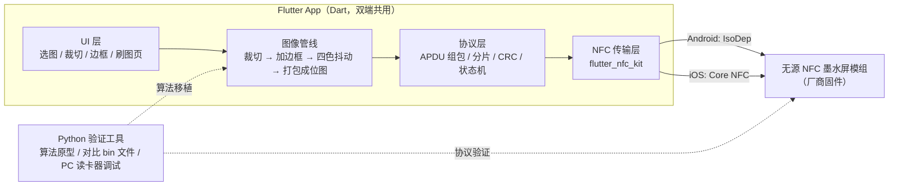
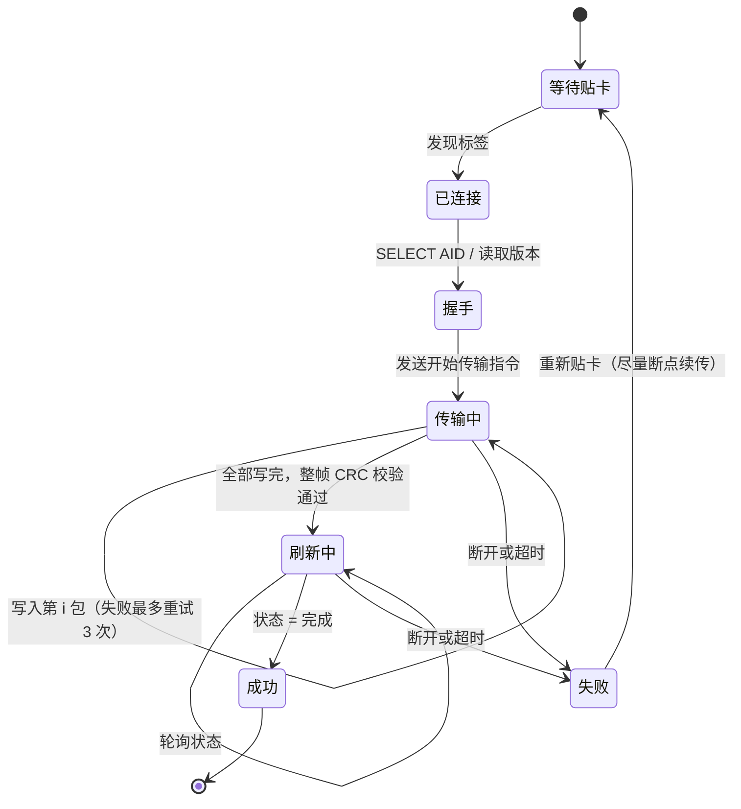
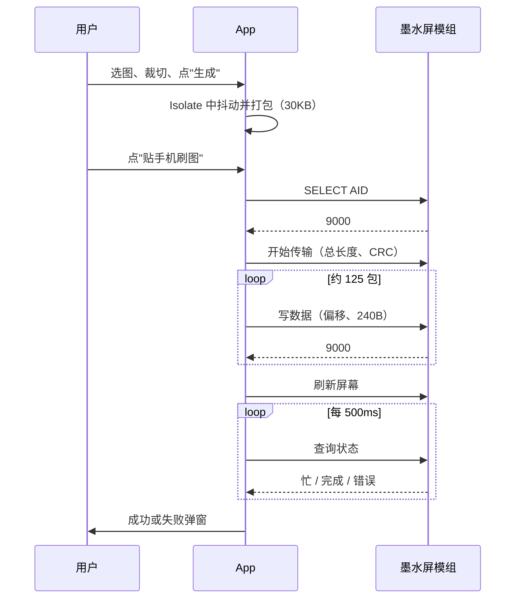

# 墨水屏 NFC 相框：技术方案与技术栈（路线 A）

> **路线 A 的定义**：屏幕模组直接向厂商采购（无源 NFC，四色 400×300），厂商负责硬件、固件和刷新波形；我们自己开发**手机 App**，负责处理图片、通过 NFC 传图和触发刷新。

---

## 1. 总体架构



**原则：**
- 所有计算（抖动、打包）都在**贴卡之前**做完，NFC 阶段只负责发数据。
- 图像管线和协议层用**纯 Dart** 实现，双端共用、能单元测试。
- 只有 NFC 传输层涉及平台差异，优先用插件，插件不够用时再写 Platform Channel。

---

## 2. 模块方案

### 2.1 图像管线（纯 Dart，在 Isolate 中运行）

| 步骤 | 说明 | 关键点 |
|---|---|---|
| ① 读图 | `image_picker` 从相册选图 | 读取 EXIF 方向并纠正 |
| ② 裁切和缩放 | 用户手势裁切，输出可视区域 | 按屏幕比例 4:3 锁定裁切框 |
| ③ 加拍立得边框 | 在 400×300 画布上留白边（底边更宽） | 边框宽度可调，有多套样式模板 |
| ④ 预处理 | 适当提高对比度和饱和度 | 墨水屏颜色发灰，需要补偿 |
| ⑤ 四色量化和抖动 | Floyd–Steinberg 或 Atkinson 误差扩散 | **调色板用实测颜色**，颜色距离用 Lab 或加权 RGB |
| ⑥ 位图打包 | 每像素 2 bit，共 30,000 字节 | 严格按厂商定义的颜色编码、位序、扫描方向 |
| ⑦ 预览 | 把打包结果反向解码成图片显示 | 用户看到的就是屏幕上的实际效果 |

**调色板示例**（要换成对你那块屏的实测值）：

| 颜色 | 理论 RGB | 实测 RGB（示例） | 编码（以厂商为准） |
|---|---|---|---|
| 黑 | 0,0,0 | 30,30,35 | `00` |
| 白 | 255,255,255 | 200,200,190 | `01` |
| 黄 | 255,255,0 | 210,180,20 | `10` |
| 红 | 255,0,0 | 160,30,30 | `11` |

### 2.2 协议层（纯 Dart）

- **APDU 构造**：按 `CLA INS P1 P2 Lc Data Le` 格式封装每一条指令：开始传输、写入数据、刷新屏幕、查询状态。
- **分片**：30 KB 按单包大小（比如 240 字节）切开，P1/P2 或数据头里带偏移量和序号。
- **校验**：单包 CRC 加整帧 CRC（CRC16 或 CRC32，以厂商为准）。
- **状态机**：



### 2.3 NFC 传输层

| 项目 | Android | iOS |
|---|---|---|
| 系统 API | `NfcAdapter.enableReaderMode` + `IsoDep` | `NFCTagReaderSession` + `NFCISO7816Tag` |
| 触发方式 | 前台页面自动检测 | **必须用户点击按钮**才弹出系统扫描框 |
| 超时 | `IsoDep.setTimeout()` 可调大（如 5000 ms） | 会话最长约 60 秒，超时要重新发起 |
| 单包上限 | `getMaxTransceiveLength()` | 短 APDU 255 字节，扩展 APDU 要芯片支持 |
| 进度提示 | 自己画的 UI | 用 `alertMessage` 更新系统弹框文案，比如"传输中 45%" |
| 配置 | `AndroidManifest.xml` 里加 NFC 权限和 feature | 开启 Entitlement、配置 Info.plist 用途描述和 AID 列表 |

**一次刷图的时序：**



### 2.4 UI 页面

| 页面 | 组件 |
|---|---|
| 首页 | 选择照片、最近作品、边框样式列表 |
| 编辑页 | 拖动缩放裁切、白边宽度滑杆、亮度/对比度/饱和度、实时四色预览 |
| 刷图页 | 贴卡引导动画（手机背面靠屏幕的示意）、进度条、剩余时间、成功/失败弹窗和重试 |
| 设置页 | 屏幕型号选择（以后支持多款屏）、调色板校准、关于/隐私 |

---

## 3. 技术栈清单

### 3.1 算法验证（Python，PC 端）

| 用途 | 技术 |
|---|---|
| 语言 | Python 3.11+ |
| 图像处理 | Pillow、NumPy |
| 抖动参考实现 | `hitherdither`、Pillow `quantize(palette, dither=FLOYDSTEINBERG)` |
| 色彩空间 | `colormath` 或 `scikit-image`（Lab 转换） |
| 调试 NFC 协议 | `pyscard`（PC/SC）+ USB 读卡器（ACR122U / ACR1252U） |
| 产出物 | 参考 bin 文件（Dart 实现要和它**逐字节一致**） |

### 3.2 App 主体（Flutter）

| 用途 | 技术或包 |
|---|---|
| 框架 | Flutter 3.x / Dart 3.x |
| 状态管理 | Riverpod（或 Provider） |
| 路由 | go_router |
| 选图 | `image_picker` |
| 裁切 | `crop_your_image` 或 `image_cropper` |
| 像素运算 | `image`（纯 Dart）+ `Uint8List`/`Float32List` 手写抖动 |
| 后台计算 | `Isolate.run()` / `compute()` |
| NFC | **`flutter_nfc_kit`**（两端都支持 ISO7816 APDU 和 iOS 弹框文案）；不够用时自己写 MethodChannel |
| CRC | `crclib` 或自己实现 CRC16/32 |
| 本地存储 | `shared_preferences`（设置）、`path_provider`（作品缓存） |
| 测试 | `flutter_test`（算法单元测试、bin 文件比对）、`integration_test` |

### 3.3 原生平台（必要时写 Platform Channel）

| 平台 | 技术 |
|---|---|
| Android | Kotlin、Android Studio、Gradle；`android.nfc.tech.IsoDep` / `NfcA`；minSdk 21 以上 |
| iOS | Swift、Xcode 15+；`CoreNFC`（`NFCTagReaderSession`、`NFCISO7816Tag` / `NFCMiFareTag`）；iOS 13+，iPhone 7 及以上 |

### 3.4 工具和硬件

| 类别 | 内容 |
|---|---|
| 开发机 | **Mac**（iOS 编译必须用 Mac） |
| 账号 | Apple Developer（每年 99 美元）；国内安卓市场需要软著和企业资质 |
| 测试机 | 至少 3 台安卓（不同品牌，NFC 天线位置不同）和 2 台 iPhone（新旧各一台） |
| NFC 调试 | ACR122U 读卡器、手机 App "NFC Tools" / "NXP TagInfo"（查看芯片类型和协议） |
| 测色 | 色度计，或者用相机在标准光源下拍照取色 |
| 版本管理和 CI | Git、GitHub Actions 或 Codemagic（Flutter 双端自动打包） |

### 3.5 需要掌握的知识

| 方向 | 掌握程度 |
|---|---|
| Dart / Flutter 基础和异步（Future/Stream/Isolate） | 熟练 |
| 数字图像基础（RGB、色彩空间、量化、误差扩散） | 理解原理 |
| 位运算和字节序（打包位图、APDU、CRC） | 熟练 |
| ISO 14443-4 / ISO 7816-4 APDU 格式和状态字（9000、6A82…） | 理解 |
| Android NFC 和 iOS Core NFC 的权限与生命周期 | 理解 |
| Kotlin / Swift | 能读能改（写插件桥接时用到） |
| iOS 签名、Entitlement、上架流程 | 会操作 |

---

## 4. 必须向厂商拿到的资料（对接清单）

- [ ] 芯片型号和支持的协议（ISO14443-4 / Type 2 / ISO15693）。**这决定了 iOS 能不能做**
- [ ] AID（如果用 ISO7816），需要写进 iOS Info.plist
- [ ] 完整指令表：开始传输、写数据、刷新、查询状态、读版本或屏幕型号
- [ ] 单包最大字节数、偏移和序号字段的格式、CRC 算法（多项式、初值、是否取反）
- [ ] 位图格式：颜色编码、高位在前还是低位在前、扫描起点和方向、是否分平面
- [ ] **一张参考图和对应的 bin 文件**（用来验证打包是否正确）
- [ ] 刷新时长、刷新期间手机要不要保持贴着、断电后的行为、能否断点续传
- [ ] 推荐的贴卡位置和场强要求、已验证过的手机机型列表
- [ ] Android 或 iOS 的 Demo 源码（如果有）

---

## 5. 工程目录结构（建议）

```
eink_frame/
├── tools/                    # Python 验证工具
│   ├── dither.py             # 抖动参考实现
│   ├── pack.py               # 位图打包，输出参考 bin
│   └── nfc_pc_test.py        # pyscard + ACR122U 协议调试
├── app/                      # Flutter 工程
│   ├── lib/
│   │   ├── core/
│   │   │   ├── image/        # crop.dart, frame.dart, dither.dart, packer.dart
│   │   │   ├── protocol/     # apdu.dart, crc.dart, transfer_state_machine.dart
│   │   │   └── nfc/          # nfc_transport.dart（封装 flutter_nfc_kit）
│   │   ├── features/
│   │   │   ├── home/  editor/  flash/  settings/
│   │   └── main.dart
│   ├── test/                 # 与 tools/ 生成的 bin 逐字节比对
│   ├── android/              # AndroidManifest NFC 权限
│   └── ios/                  # Info.plist、Runner.entitlements
└── docs/                     # 厂商协议、调色板实测数据
```

---

## 6. 里程碑

| 阶段 | 内容 | 周期 | 验收标准 |
|---|---|---|---|
| M0 选型 | 买 2–3 家模组，用 TagInfo 确认协议，拿到资料 | 1–2 周 | 拿到 AID、指令表和参考 bin |
| M1 PC 验证 | Python 抖动加打包，用 ACR122U 刷出第一张图 | 1 周 | 屏幕显示正确，没有乱码 |
| M2 算法移植 | Dart 版图像管线 | 1 周 | 和 Python 输出逐字节一致，耗时不到 1 秒 |
| M3 Android 打通 | Flutter + flutter_nfc_kit 刷图 | 1 周 | 3 台机器连续刷 20 次，成功率 95% 以上 |
| M4 iOS 打通 | Entitlement、Info.plist 配置，真机刷图 | 1–2 周 | 2 台 iPhone 成功率 90% 以上 |
| M5 UI 完善 | 编辑页、刷图引导、异常处理 | 2 周 | 完整流程可用 |
| M6 上架 | 打包 APK/IPA，准备审核材料和演示视频 | 1 周 | 审核通过 |

**合计约 8–10 周。**

---

## 7. 风险与对策

| 风险 | 对策 |
|---|---|
| 芯片不支持 iOS 能识别的协议 | M0 阶段就用 iPhone 实测，不行立即换厂商 |
| 四色屏刷新时间长（15–30 秒），手机一动就失败 | 引导动画加震动提示；轮询状态；要求厂商支持断点续传或缓存后续刷 |
| 颜色偏差大 | 用实测调色板、预增强饱和度、在 App 里提供校准页 |
| 位图乱码 | 参考 bin 逐字节比对的单元测试，接入 CI |
| iOS 审核被拒 | 用途描述写清楚（"使用 NFC 向电子墨水屏相框传输照片"），附真机演示视频 |
